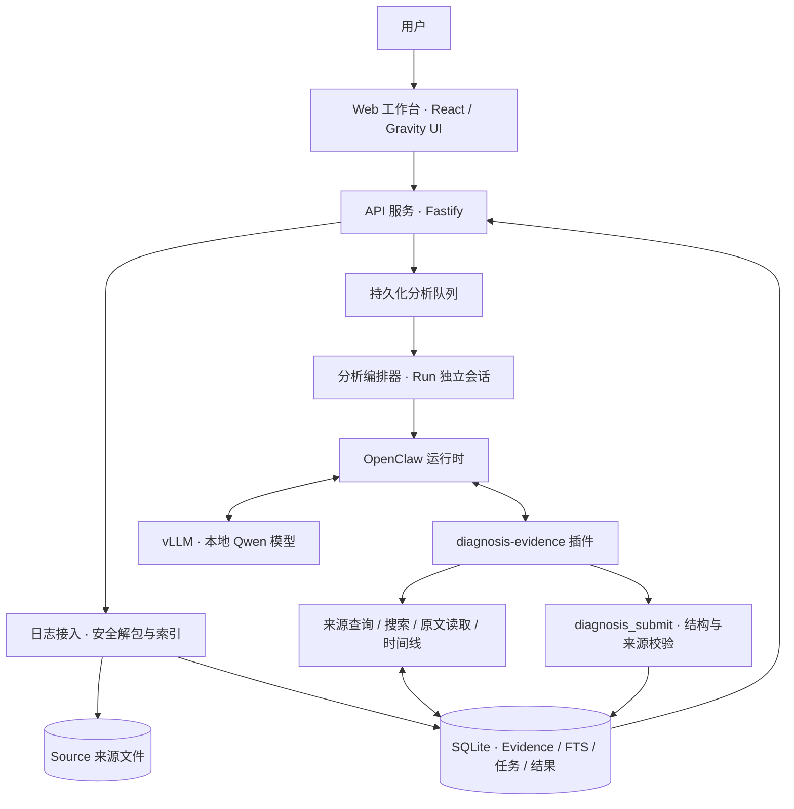

# OpenClaw Diagnosis V3

> **公开展示说明**：以下内容同步自项目源码仓库的 README，用于介绍功能、架构与设计。应用源码、部署脚本及内部文档仍保存在私有仓库中，不对外提供。文中的实现路径、开发命令和“仓库”描述指源码仓库，不代表本展示仓库包含这些文件。

面向服务器日志分析的本地 AI 诊断系统。

OpenClaw Diagnosis 将日志接入、证据检索、智能体推理与结果发布组织为一条可追溯的诊断流程。系统使用 OpenClaw 管理智能体执行，通过 vLLM 调用本地 Qwen 模型，并以受限的 Evidence 工具为模型提供日志原文与来源信息，输出包含证据引用、分析范围和后续建议的结构化诊断结果。

项目采用 TypeScript monorepo 组织 Web 工作台、API 服务与 OpenClaw 插件，适用于本地部署的服务器日志排查与诊断结果复核。当前仓库的模型配置为 `Qwen3.8-27B-FP8`。

## 核心能力

- **日志接入与证据索引**：接收日志包，执行安全解包和资源限制，保留来源文件，并建立可定位到原文片段的 Evidence 索引。
- **基于工具的自主取证**：模型按诊断需要检索日志、读取上下文、查看时间线，并结合支持证据与反证形成结论。
- **结构化结果与版本追踪**：统一表达故障、未发现故障和证据不足三类结果；同一日志包可重新分析，并保留 Run 与 Revision 关系。
- **持久化任务调度**：使用 SQLite 保存分析队列、执行状态与检索预算，支持并发限制和服务重启后的任务恢复。
- **Web 工作台**：提供登录、上传、队列进度、诊断结果，以及受权限控制的采集脚本生成、审计和账号管理功能。

## 系统架构

系统由交互层、应用服务层、证据层和智能体推理层组成。API 服务负责业务流程与任务调度；OpenClaw 负责模型与工具之间的执行循环；Evidence 插件连接受限检索接口与持久化数据。



### 模块职责

| 模块 | 实现位置 | 主要职责 |
| --- | --- | --- |
| Web 工作台 | `apps/web` | 用户交互、日志上传、任务状态和诊断结果展示；采集、审计与账号管理页面 |
| API 服务 | `apps/api/src/server.ts` | 身份认证、权限校验、Case 与 Run 接口，以及前端静态资源托管 |
| 日志与证据处理 | `apps/api/src/archive.ts`、`evidence.ts` | 安全解包、来源保存、原文分片与全文索引 |
| 任务调度与编排 | `apps/api/src/queue.ts`、`orchestrator.ts` | 持久化队列消费、并发控制、OpenClaw 调用、截止时间与失败处理 |
| Evidence 插件 | `plugins/diagnosis-evidence` | 会话身份绑定、限定 Case 的证据检索、上下文预算和结构化结果提交 |
| OpenClaw 运行时 | `runtime/workspace`、`deploy/configure-openclaw.sh` | 诊断行为配置、工具授权与智能体运行环境 |
| 本地推理服务 | `deploy/start-qwen38-openclaw.sh` | 通过 vLLM 提供兼容 OpenAI API 的本地模型服务 |

API 与 Evidence 插件访问同一 SQLite 数据库。来源文件保存在本地数据目录中，模型通过受限工具读取已索引的日志内容。当前检索采用 SQLite FTS 全文搜索，不依赖向量数据库。

## 诊断流程

1. **接入日志**：用户上传日志包，API 创建 Case，完成解包、来源保存与 Evidence 索引。成功后 Case 进入 `READY` 状态。
2. **创建分析任务**：分析请求创建 Run 并进入 `PENDING` 队列；同一 Case 已有待处理或执行中的任务时，接口返回现有任务。
3. **启动独立会话**：队列认领任务后将其置为 `RUNNING`，编排器使用 `diag-<runId>` 启动 OpenClaw 会话。
4. **检索与推理**：模型查看来源概览，自主选择检索词、来源范围和原文片段，在预算内收集证据、检查反证并形成诊断。
5. **提交与校验**：模型调用 `diagnosis_submit` 提交结构化结果。服务端校验字段、结果一致性、引用存在性、Case 归属及当前 Run 的检索记录。
6. **保存与展示**：通过校验的结果写入数据库，由 API 返回工作台；重新分析生成新的 Run 与版本关系，复用已有来源和证据索引。

模型执行失败或未完成有效提交时，系统保留失败状态及已有证据，展示分析不可用信息，支持重新分析。

## 证据与数据模型

| 对象 | 含义 |
| --- | --- |
| **Case** | 一次日志上传形成的诊断案例，记录上传者及接入状态 |
| **Source** | Case 内保存的来源文件，记录路径、大小与行数等元数据 |
| **Evidence** | 可引用的原文片段，包含稳定标识、来源、位置及可提取的时间信息 |
| **Run** | 一次分析执行，绑定 Case、会话授权、执行状态、检索记录和资源预算 |
| **Diagnosis / Revision** | Run 产生的结构化诊断，以及同一 Case 多次分析之间的版本关系 |

一个 Case 可以包含多个 Source 和 Evidence，也可以产生多个 Run。证据按 Case 组织，分析会话、授权和检索记录按 Run 隔离。各 Run 使用共享的受控 workspace，不创建独立物理工作目录。

### 诊断工具

运行时仅开放以下五个诊断工具：

| 工具 | 用途 |
| --- | --- |
| `diagnosis_list_sources` | 查看来源清单、目录概览与可用的采集覆盖信息 |
| `diagnosis_search_evidence` | 使用模型选择的关键词进行全文搜索，支持来源过滤与分页 |
| `diagnosis_read_evidence` | 读取指定证据或来源片段，按偏移继续读取上下文 |
| `diagnosis_build_timeline` | 返回当前 Case 中带时间信息的证据 |
| `diagnosis_submit` | 提交最终结构化诊断，并执行发布校验 |

前四个工具提供证据查询；提交工具写入诊断结果。插件还会持久化检索记录与预算，因此“只读取证”指不修改来源内容，不表示插件以只读方式访问数据库。

## 设计原则与边界

### 推理与确定性处理分工

模型负责提出假设、选取证据、检查反证、判断故障或证据不足，并给出后续建议。确定性代码负责安全接入、索引、查询执行、权限与资源控制，以及结果结构和引用校验。系统不以规则结论或历史诊断替代失败的模型分析。

### 证据约束与结果含义

正式结果必须经由 `diagnosis_submit` 发布，不能以普通会话文本代替。提交包含分析范围、支持证据、反证检查、推断限制、覆盖说明与阻断性未知项等自检信息。

`OFFICIAL` 表示结果通过当前版本的结构与来源校验，不代表诊断正确性认证。校验确认引用存在、归属正确且曾由本 Run 的工具返回，不判断引用内容是否足以证明因果。`NO_FAULT` 仅适用于模型声明的已检查范围；模型置信度属于自评。

### 会话与权限隔离

插件从可信运行时会话绑定 Run，在服务端派生 capability，并检查对应 Case、授权哈希与任务状态。模型可见的工具参数不包含 Run 身份或授权凭据。

普通用户对 Case 与 Run 的访问受所有权约束；管理与审计能力由角色和权限配置控制。账号密码使用带随机盐的 `scrypt` 哈希保存。

### 受限运行环境

仓库提供的 OpenClaw 配置仅允许诊断工具，禁用终端、任意文件访问、浏览器、外网检索、消息通道及记忆相关能力。日志、路径和采集 Manifest 均按不可信输入处理；Manifest 表示上传数据中的采集覆盖声明，不构成真实性认证。

以上描述对应仓库代码与部署配置，实际运行环境应与部署配置保持一致。

## 调度与资源控制

分析队列由 API 进程消费，默认并发为 `1`，通过 `DIAG_ANALYSIS_CONCURRENCY` 调整。服务重启后，采用 `HMAC_V1` 授权方案的未完成任务可恢复调度；这不等同于恢复模型进程中的执行现场。

| 配置或限制 | 当前默认值 |
| --- | --- |
| 分析并发 | `1` |
| 队列轮询间隔 | `1,000 ms` |
| 单 Run 总分析截止时间 | `600 s`，覆盖最多两次 CLI turn |
| 单 Run 检索预算 | `18,000` 字节 / `14` 次调用 |
| 来源清单子预算 | `6,000` 字节 / `2` 次调用，包含在总预算内 |
| 单次原文读取上限 | `4` 条，每条 `1,200` 字符，并受剩余预算约束 |

检索采用分页、片段偏移与自适应裁剪控制上下文规模，并为原文读取保留预算。片段被返回不代表完整文件已读，预算耗尽也不代表已完成全部取证。API 超时会关闭任务提交资格并处理 CLI 取消；队列释放不保证 Gateway 或模型端的计算已立即停止。

## 部署组成

仓库提供基于 Linux systemd 的服务配置：

- `diagnosis-api.service`：运行 API、队列消费者并托管构建后的 Web 资源，配置端口为 `8080`。
- `openclaw-diagnosis.service`：运行 OpenClaw Gateway，配置端口为 `18789`，加载 Evidence 插件。
- `vllm-qwen38.service`：作为模型服务依赖，由 vLLM 提供推理；仓库提供对应启动脚本，默认端口为 `8000`。

本地模型启动脚本使用 `Qwen3.8-27B-FP8`，默认上下文长度为 `32,768`，启用自动工具调用与 `qwen3_xml` 工具解析。模型路径、服务地址及部分推理参数可通过环境变量配置。部署步骤与历史验证记录见 部署文档（内部文档，未公开）。

## 开发与验证

Node.js 版本要求：`>=24.19.0`。

```bash
npm install
npm run check
npm test
npm run build
```

以上命令用于依赖安装、类型检查、测试与构建。完整诊断运行还需要配置 OpenClaw、Evidence 插件、本地模型服务及服务环境变量。

## 文档索引

- 架构细节与实现边界（内部文档，未公开）
- 账号与队列实现（内部文档，未公开）
- 日志采集实现（内部文档，未公开）
- 审计复核与回退记录（内部文档，未公开）
- 检索覆盖与质量复核（内部文档，未公开）

带日期的文档保留对应阶段的实现、实验与验收记录；当前行为应结合源码和部署配置确认。
